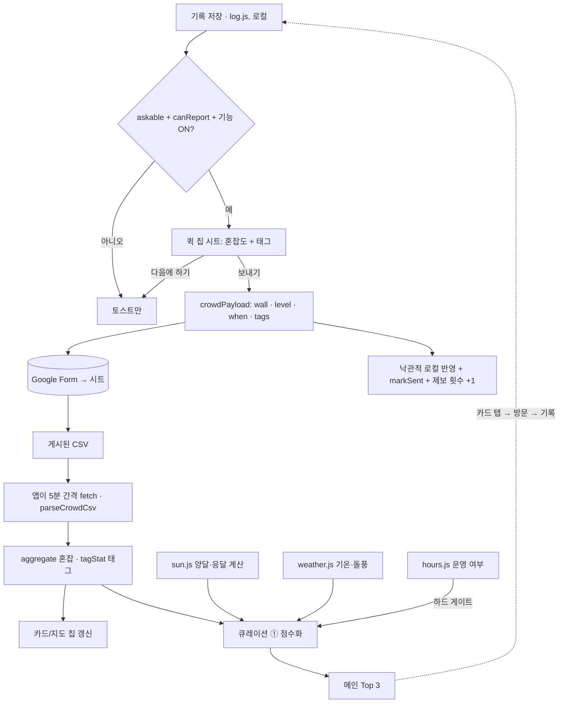

# PRD · 인공외벽 등반 기록 직후 "3초 현장 태그" & 자동 큐레이션

| 항목 | 내용 |
|---|---|
| 서비스 | 해벽 · haebyeok.app (서버·빌드 없는 바닐라 JS 정적 웹앱) |
| 범위 | **인공외벽 모드**. (자연암벽/해안 암장은 이 문서의 범위가 아님. 이전 초안 `seacliff-curation.md`는 "해벽"을 바다로 오해한 것이라 폐기) |
| 상태 | Draft v0.2 (2026-10-18) |
| 한 줄 요약 | 등반 기록을 저장한 직후, 글쓰기 없이 칩 1~2번 탭으로 현장 상태를 제보하게 하고, 그 데이터로 "지금 사람 적고 운동하기 좋은 외벽" 같은 자동 큐레이션을 만든다. |

---

## 0. 먼저 알아둘 현재 구조 (이 기획이 올라탈 기반)

코드를 확인해 보니 이미 절반은 있다. 새로 만들기보다 **확장**하는 쪽이 맞다.

| 이미 있는 것 | 위치 | 이 PRD에서의 쓰임 |
|---|---|---|
| 기록은 이 브라우저(localStorage)에만 저장, 서버 전송 없음 | `src/log.js` | 기록 저장 로직은 **건드리지 않음**. 현장 제보는 기록과 별개로 "공개 제보"로 전송 |
| 기록 추가 시트 + 혼잡도 질문(여유/보통/혼잡) | `src/log-view.js`, `src/crowd.js` | 혼잡도는 **그대로 현장 제보의 혼잡 축**으로 사용 (§2.2 결정 1) |
| 제보 전송: Google Form `formResponse` POST, 읽기: 게시된 CSV(제보시각·암장·단계·방문시각) | `config.crowdEndpoint/crowdCsvUrl`, `crowdPayload` | 같은 폼/시트에 **열 추가**(태그). 서버·인프라 신규 없음 |
| 남용 방지: 30분 쿨다운, 외벽당 하루 2회, 하루 5회, 방문 1회당 1제보 | `canReport`, `open-wall:crowd-sent` | 태그 제보도 같은 장부를 공유 (한 번의 제보 = 혼잡도 + 태그) |
| 시간대·요일 보정 집계(평일/주말·공휴일, ±60분, 최근 8주, 3건 미만이면 "제보 모으는 중") | `aggregate` | 큐레이션의 혼잡 입력으로 재사용 |
| 양달·응달은 태양 위치·지형 그림자로 **계산** | `src/sun.js`, `src/shadow.js` | 태그 "양달 따뜻함"은 계산값과 **교차 검증되는 체감 제보**로 취급 |
| 바람/기온 예보 | `src/weather.js` (`GUST_STRONG`) | "바람 셈/추움" 태그와 대조 |
| 도장(스탬프) | `src/stamp.js`, `year-seal-view.js` | 보상은 새 배지 시스템이 아니라 기존 스탬프/토스트 활용 (§2.4) |
| 토스트 | `log-view.js` `toast()` | 감사 메시지 |

**제약 두 가지**
1. **로그인·프로필이 없다.** "프로필 완등 배지"는 계정이 없어서 불가 → 기기 안(localStorage)에서만 쌓이는 "내 제보 N회" 정도로 대체.
2. **게시된 CSV는 누구나 읽을 수 있다.** 자유 입력 한마디를 그대로 공개하면 스팸·개인정보 위험 → v1은 **칩만** 공개, 한 줄 메모는 비공개/운영자 승인 후 노출 (§2.3).

---

## 1. 목표 / 비목표

**목표**
1. 기록 저장 직후 **탭 2번 이내, 5초 안에** 끝나는 현장 제보 UX.
2. 제보가 쌓이면 카드의 실시간 칩과 메인의 자동 큐레이션이 사람 손 없이 최신화.
3. 제보 참여율을 높이되 기록 저장 자체는 절대 방해하지 않는다.

**비목표 (v1)**: 로그인/배지 시스템, 사진 제보, 자유 텍스트 공개, 푸시 알림, 실시간 소켓(수 분 지연 허용).

---

## 2. 플로우 & 화면 기획

### 2.1 전체 플로우

```
[1] 기록 저장 (기존 기록 추가 시트)
      │  저장은 항상 먼저, 즉시, 로컬에 완료됨
      ▼
[게이트] 제보 가능한가?  ──아니오──▶ 기존 토스트만 ("기록했어요") 끝
   ├ 현장 제보 기능 켜짐 (config)
   ├ askable: 지금 이전 · 최근 7일 이내 방문
   └ canReport: 쿨다운/일일 상한/중복 아님
      │ 예
      ▼
[2] 성취 + 초대 (저장 직후 바텀시트)
      "🎉 뚝섬외벽 기록 완료!  현장 분위기 3초만 알려주실래요?"
      [⚡ 3초 만에 알려주기]   [다음에 하기]
      │
      ▼
[3] 퀵 칩 선택 (키보드 없음)
      혼잡도 1개 (한적해요/보통/사람 많음) + 태그 0~3개
      [보내기]  (혼잡도를 고르면 활성)
      │
      ▼
[4] 즉시 반영 & 감사
      토스트: "제보 고마워요! 뚝섬외벽 카드에 반영됐어요"
      카드의 실시간 칩에 내 제보가 낙관적으로 먼저 표시 (CSV 반영은 수 분 지연)
      └ 내 제보 횟수 +1 (기기 내), 5회마다 스탬프 문구 한 줄
```

### 2.2 [3] 퀵 칩 구성

**원칙**: 화면 스크롤 없이 한 화면, 칩 탭만, 키보드 없음.

| 행 | 칩 | 선택 | 성격 | 유효시간(§3.2) |
|---|---|---|---|---|
| 👥 혼잡도 | 🍃 한적해요(`여유`) · 보통 · 🔥 사람 많음/대기(`혼잡`) | 단일 | 일시적 | 90분 |
| ☀️ 날씨·그늘 | ☀️ 양달 따뜻함 · 🌳 응달 시원함 · 🥶 바람 셈/추움 | 복수 | 일시적 | 3시간 |
| 🧗 이용 편의 | ✨ 벽 상태 좋음 · 🚗 주차 편함 · 🧗 초보자 붙기 좋음 | 복수 | 지속적 | 30일 |

**결정 1 — 혼잡도는 새로 만들지 않고 기존 `여유/보통/혼잡`을 쓴다.**
제안서의 "한적해요 / 사람 많음·대기"는 이미 있는 `여유/혼잡`과 같은 축이다. 새 태그로 만들면 같은 정보가 두 곳에 쌓여 집계가 갈라진다. 라벨만 친근하게("한적해요" 표시, 저장값은 `여유`) 바꾸고 `보통`은 유지한다. 지금은 기록 추가 시트 안에 있는 혼잡도 질문을 이 단계로 **옮긴다**(저장 전 마찰 감소). 옮긴 뒤 제보율이 떨어지면 되돌릴 수 있게 설정값으로 둔다.

**결정 2 — 방문한 지 오래된 기록에는 일시적 태그를 묻지 않는다.**
"양달 따뜻함"은 3일 전 방문엔 의미가 없다. 방문 시각이 3시간 이내면 전 행, 그 이전(최대 7일)이면 **이용 편의 행과 혼잡도만** 노출.

**결정 3 — 상충 칩 처리.** `양달 따뜻함` ↔ `응달 시원함`은 상호 배타(하나 선택 시 다른 쪽 해제). 계산된 양달/응달과 정반대 제보는 막지 않되 §5에서 가중치를 낮춘다.

**시각 사양**
- 칩 높이 ≥ 44px, 한 행 줄바꿈 허용, `aria-pressed` 토글, 선택 시 색+체크 아이콘(색만 의존 금지).
- 보내기 버튼 sticky, 건너뛰기는 텍스트 링크로 항상 가능. 시트 닫기/뒤로가기 = 건너뛰기.
- 기존 `crowd-pill` 스타일 재사용, 새 클래스는 `qt-` 접두.

### 2.3 한 줄 한마디 (선택) — v1은 공개하지 않음
- 제안: "지금 사람 적어서 바짝 붙기 좋아요!" 같은 메모.
- 위험: 게시된 CSV는 공개 + 필터링 불가 → 욕설·연락처·광고가 그대로 노출.
- **v1**: 입력칸 없음. **v1.5**: 메모 열을 추가하되 앱은 시트의 `승인` 열이 체크된 행만 읽어 노출(운영자 검수). 길이 ≤ 40자, URL/전화번호 패턴은 읽는 쪽에서도 차단.

### 2.4 [4] 보상 설계 (계정 없이)
- 즉시: 토스트 + 해당 외벽 카드에 내 제보가 "방금" 표시.
- 누적: 기기 내 제보 횟수(`open-wall:crowd-sent`와 별도의 카운터 키). 기록 탭 상단에 "현장 제보 7회 🙌". 계정이 없으므로 기기 변경 시 초기화됨 — 기존 `backup.js`에 포함할지는 §7.
- 스탬프: 새 배지를 만들지 않고 **기존 외벽 도장** 옆에 "제보 도장" 작은 마크를 붙이는 정도로 시작. 별도 도장 아트워크는 v1.5.
- 금지: 제보 개수로 순위 경쟁 노출(어뷰징 유인).

### 2.5 카드/지도 반영 (실시간 현황)
```
┌──────────────────────────────────────┐
│ 뚝섬외벽                    ● 운영 중   │
│ 🍃 한적해요 · 3명 제보 · 12분 전        │  ← 기존 crowd chip
│ ☀️ 양달 따뜻함 · 🥶 바람 셈 (2시간 전)   │  ← 새 태그 칩 (유효시간 내만)
│ ✨ 벽 상태 좋음 12 · 🚗 주차 편함 9      │  ← 지속 태그 집계 (건수)
└──────────────────────────────────────┘
```
- 일시적 태그는 유효시간이 지나면 **사라진다**(오래된 날씨 제보가 거짓 정보가 되지 않게).
- 건수 3 미만이면 태그 숨김 + "제보 모으는 중" (기존 `MIN_REPORTS` 규칙과 동일).
- 계산된 양달/응달과 제보가 다르면 "계산: 응달 / 제보: 양달 따뜻함"처럼 **둘 다** 보여 판단하게 한다.

---

## 3. 데이터

### 3.1 전송 (Google Form 항목 추가)
현재 `crowdPayload(fields, wall, level, when)`에 **태그 항목 하나**를 추가한다.

| 폼 항목 | 값 | 비고 |
|---|---|---|
| wall | 외벽 이름 | 기존 |
| level | `여유`/`보통`/`혼잡` | 기존. v1은 선택 필수로 두어 기존 집계를 바꾸지 않음 |
| when | `YYYY-MM-DD HH:mm` 방문시각 | 기존 |
| **tags (신규)** | 쉼표로 이은 키: `sunny_warm,windy_cold,wall_good` | 단답형 한 칸. 체크박스형 대신 단답형을 쓰는 이유: 폼 검증에 의존하지 않고 앱이 화이트리스트로 읽는다 |

**태그 키(고정 사전)**

| key | 라벨 | 유형 |
|---|---|---|
| `sunny_warm` | ☀️ 양달 따뜻함 | 일시적 |
| `shade_cool` | 🌳 응달 시원함 | 일시적 |
| `windy_cold` | 🥶 바람 셈/추움 | 일시적 |
| `wall_good` | ✨ 벽 상태 좋음 | 지속 |
| `parking_easy` | 🚗 주차 편함 | 지속 |
| `beginner_ok` | 🧗 초보자 붙기 좋음 | 지속 |

- 시트 열 순서: `제보시각 · 암장 · 단계 · 방문시각 · 태그`. 현재 파서(`parseCrowdCsv`)는 4번째 열까지만 읽으므로 **5번째 열 추가는 하위 호환**.
- 태그만 보내는 제보(혼잡도 생략)를 허용하려면 현재 "단계가 없으면 행을 버리는" 파서를 완화해야 함 → §7.

### 3.2 읽기 모델 (`quicktag.js`, 순수 모듈 · DOM/네트워크 없음)
```
parseTagCell(cell)            → 화이트리스트 키 배열 (알 수 없는 키/중복/6개 초과 버림)
parseCrowdCsv(text, names)    → [{t, wall, score, tags[]}]   // 기존 반환에 tags 추가
tagStat(reports, wall, now)   → {
   transient: { key → {n, lastT} }   // 유효시간 내 (혼잡 90분 / 날씨 3시간)
   lasting:   { key → n }            // 최근 30일
}
```
유효시간·최소 건수는 모듈 상단 상수로 노출(`TTL_MIN`, `LASTING_DAYS`, `MIN_TAG_REPORTS = 3`) — `crowd.js`의 스타일과 동일.

### 3.3 이후 확장 (v2: Worker)
제보량이 늘어 CSV 지연·행 수 한도(`MAX_ROWS=20000`)가 문제 되면 기존 Worker(`config.boardUrl`)에 `/v1/tags` 추가. 스키마는 그때 정의 — 지금은 불필요.

---

## 4. 자동 큐레이션 (메인 화면)

### 4.1 블록 정의
| # | 제목 | 의도 | 필요 데이터 |
|---|---|---|---|
| ① | 🍃 **지금 사람 적고 운동하기 좋은 외벽 Top 3** | 지금 가면 쾌적한 곳 | 운영 중 + 혼잡 + 날씨/그늘 + 벽 상태 |
| ② | ☀️ **지금 따뜻한 양달 / 🌳 시원한 응달 외벽** | 계절별 쾌적함 | 계산 양달/응달 + 제보 + 기온 |
| ③ | 🧗 **초보자 붙기 좋은 외벽** | 입문자 | `beginner_ok` 누적 + 혼잡 낮음 |

v1은 ①만 구현하고, 제보가 쌓인 뒤 ②③ 추가(§6).

### 4.2 ① 랭킹 알고리즘

```
후보 = 현재 운영 중(hours.js) 외벽           ← 하드 게이트: 닫힌 곳은 절대 추천 안 함
각 외벽 w에 대해:

 (1) 혼잡 점수 C ∈ [0,1]
     level = recent?.level ?? aggregate.level       // 방금 제보(90분) 우선, 없으면 같은 요일·시간대 평년
     C = {여유:1, 보통:0.5, 혼잡:0}[level]
     level 없음(제보 3건 미만) → 후보 제외

 (2) 쾌적 점수 K ∈ [0,1]
     바람: 예보 돌풍 ≥ GUST_STRONG 이거나 windy_cold 최근 3h 제보 ≥ 2건 → -0.5 (둘 다여도 한 번만)
     햇빛: 더운 날(≥ 26°C)  : 응달(계산) +0.3, sunny_warm 제보 -0.3
           추운 날(≤ 10°C)  : 양달(계산) +0.3, shade_cool 제보 -0.3
           그 외            : 0
     K = clamp(0.7 + 합, 0, 1)

 (3) 벽 품질 Q ∈ [0,1]
     wall_good 건수 / 최근 30일 제보 수 → 베타 스무딩 (n+1)/(N+2)

 (4) 최종점수  S = 0.6·C + 0.25·K + 0.15·Q
     신뢰도   conf = min(1, 유효 제보 수 / 5)
     S' = S · (0.5 + 0.5·conf)                      // 제보 적은 외벽이 운 좋게 1등 되는 것 방지

 정렬: S' 내림차순 → 동점은 최근 제보가 더 신선한 순. 상위 3개.
```
- 가중치(0.6/0.25/0.15)와 기온 기준은 초기 가정값. 출시 후 "추천 카드 탭 → 방문 기록 저장" 전환율로 튜닝.
- **fail-safe**: 날씨 API 실패 시 K는 중립(0.7), 혼잡 CSV 실패 시 블록 자체를 숨김(기존 지도는 정상 동작).

### 4.3 흐름도


순환: **기록 → 제보 → 큐레이션 정확도↑ → 더 많은 방문 → 더 많은 기록**.

### 4.4 메인 화면 컴포넌트
```
┌────────────────────────────────────┐
│ 🍃 지금 사람 적고 운동하기 좋은 외벽  │  갱신 3분 전 · ⓘ
│ ┌────────────────────────────────┐ │
│ │ 1  뚝섬외벽        🍃 한적해요     │ │
│ │    ☀️ 양달 따뜻함 · 1.2km        │ │
│ │    제보 5건 · 12분 전            │ │
│ └────────────────────────────────┘ │
│ │ 2 …                              │ │
│ │ 3 …                              │ │
│ 제보 3건 이상 쌓인 외벽만 추천해요     │
└────────────────────────────────────┘
```
- 빈 상태: "아직 제보가 모이는 중이에요. 다녀오셨다면 현장 분위기를 알려주세요" → 기록 추가 진입 버튼(수요 → 공급 연결).
- ⓘ 탭: 산정 기준 설명(혼잡 평년 + 방금 제보, 날씨, 벽 상태) — 투명성.
- 거리 표시는 기기에 이미 있는 위치만 사용(요청하지 않음 — 기존 `getOrigin` 원칙).

---

## 5. 어뷰징 · 신뢰
- 방문 1회당 1제보, 쿨다운 30분, 외벽당 하루 2회, 하루 5회: **기존 `canReport` 그대로**.
- 일시적 태그는 TTL로 자동 소멸 → 오염돼도 오래 안 남음.
- 기기 식별이 없으므로 같은 5분 버킷의 동일 태그는 1건으로 계산(한 사람이 연타해도 영향 제한).
- 계산값(양달/응달)과 상반된 태그는 가중치 0.5.
- 공개 CSV에는 개인정보 없음(외벽·시각·칩 키만). README의 개인정보 문구 변경은 불필요하지만, 제보 시트에 "현장 제보는 외벽·시각·선택한 칩만 공개돼요" 한 줄 표기를 권장.

## 6. 지표 · 단계

| 지표 | 목표(출시 4주) |
|---|---|
| 기록 저장 → 제보 시트 열림 (게이트 통과분 중) | ≥ 60% |
| 시트 열림 → 보내기 | ≥ 35% |
| 보내기 → 태그 1개 이상 포함 | ≥ 60% |
| 제보 3건 이상 외벽 비율(활성 외벽 중) | ≥ 50% |
| 큐레이션 ① 카드 탭 → 7일 내 기록 저장 | 기준선 측정 후 설정 |

측정은 기존 GoatCounter(`stats.js`) 이벤트로: `qt_open`, `qt_send`, `qt_skip`, `cur1_view`, `cur1_tap`.

1. **P0**: 폼 항목 추가, `quicktag.js`(파서·집계·단위테스트), 퀵 칩 시트, 카드 태그 칩. `config.quickTags` 플래그(비우면 기능 OFF).
2. **P1**: 큐레이션 ① + 빈 상태/투명성 ⓘ.
3. **P1.5**: 메모(운영자 승인제), 제보 도장 아트워크.
4. **P2**: 큐레이션 ②③, Worker 이전 검토.

**테스트(순수 모듈, `npm test`)**: 태그 셀 파싱(알 수 없는 키/중복/주입 문자열), TTL 만료 경계, 3건 미만 숨김, 상충 칩, 점수 가중·스무딩, 날씨 실패 fail-safe, 5번째 열이 없는 옛 시트 호환.

## 7. 결정 사항 (추천안 확정)

| # | 질문 | 결정 | 이유 |
|---|---|---|---|
| 1 | 혼잡도 질문을 저장 전 → 저장 후로 이동? | **이동한다.** 단 `config.quickTags`로 되돌릴 수 있게 하고, 첫 4주 `qt_open`→`qt_send` 전환율로 확인 | 저장 전 입력 마찰을 없애는 것이 이 기획의 핵심. 제보율이 기존보다 떨어지면 되돌림 |
| 2 | 제보 횟수를 백업 파일에 포함? | **v1은 포함하지 않는다** | 장식용 수치라 백업 스키마를 늘릴 가치가 낮음 |
| 3 | 태그만 보내는 제보 허용? | **허용하지 않는다.** 혼잡도 선택이 필수 | 기존 `aggregate`/파서를 바꾸지 않고, 태그는 항상 혼잡도와 같은 시점 데이터로 묶임 |
| 4 | 기온 기준(26°C/10°C)·가중치(0.6/0.25/0.15) | **초기값으로 확정**, 출시 4주 뒤 카드 탭→기록 전환율로 재조정 | 데이터 없이 더 다듬을 근거가 없음 |
| 5 | 한 줄 메모 | **v1.5에서 운영자 승인제로만**, 그 전에는 입력칸 없음 | 공개 CSV에 걸러지지 않은 텍스트가 노출되는 위험 |

## 8. 구현 위치 메모
이 저장소(`open-wall`)는 배포용 미러(`Update site: …` 커밋)이고 `package.json`·`test/`가 없다. 개발·테스트(`npm test`)와 배포 절차는 README가 말하는 **작업 저장소**(`docs/system/deploy.md`)에 있다. P0 구현(`quicktag.js`, 퀵 칩 시트, 폼 항목 추가)은 그쪽에서 진행해야 하며, 여기서 `src/`를 직접 고치면 다음 배포에서 덮어써진다.

## 9. 첫 사용 코치마크 (온보딩 투어)

퀵 태그와 별개의 기능이지만, 새 요소(현장 제보 칩)를 알리는 수단이라 같은 문서에 둔다. **UI가 어느 정도 확정된 뒤** 구현한다(투어는 화면 구조에 묶여 있어, UI가 흔들리는 동안 만들면 계속 고쳐야 한다).

### 9.1 동작
화면 위에 어두운 막을 깔고, 설명할 요소 하나만 구멍을 내어 밝게 보여준 뒤 말풍선으로 설명한다(다음/건너뛰기). 구멍은 대상 요소의 위치를 읽어 만들고, 스크롤·회전·글자 크기 변화에 다시 계산한다.

### 9.2 단계 (확정 UI 기준 4~5개)
| 순서 | 대상 | 설명 |
|---|---|---|
| 1 | 탭 아이콘(지도·목록·기록) | 화면 구성 |
| 2 | 필터 | 지금 열린 곳 등으로 좁히는 법 |
| 3 | 외벽 카드 | 양달·응달 막대, 혼잡 칩, ♥, 길찾기 |
| 4 | 다녀왔어요 / 기록 추가 | 기록은 이 브라우저에만 저장됨 |
| 5 | 현장 제보 칩 *(퀵 태그 출시 후)* | "다녀오셨다면 3초만" |

### 9.3 누구에게 무엇을 보이는가 (핵심 규칙)
**원칙 하나로 모두 해결한다: 단계마다 id와 도입 버전을 갖고, 기기에 "본 단계 id 목록"을 저장한다. 보여줄 것 = 아직 안 본 단계.**

| 사용자 | 저장된 "본 단계" | 보이는 것 |
|---|---|---|
| 신규 방문자 | 없음 | 전체 투어 |
| **이미 방문했지만 투어를 본 적 없는 사람** | 없음(키 자체가 없음) | 전체 투어 (아래 9.4 완충 적용) |
| 투어를 끝까지 본 사람 | 모든 현재 단계 | **아무것도 안 보임** |
| 투어를 건너뛴 사람 | 건너뛰는 순간 현재 단계 전부를 "봄"으로 기록 | 아무것도 안 보임 (건너뛰기도 의사 표시) |
| 투어를 본 뒤 새 기능이 추가됨 | 이전 단계만 있음 | **새로 추가된 단계만** 해당 요소가 나타날 때 한 단계씩 |

- 저장 키가 없는 기존 사용자는 자동으로 "아직 안 본 사람"으로 취급되므로 별도 마이그레이션이 필요 없다.
- 단계 하나 = 한 번만 보임. 같은 단계가 두 번 뜨지 않는다.

### 9.4 거슬리지 않게
- **기존 방문자는 한 줄 토스트로 먼저 묻는다.** "새로 생긴 안내가 있어요 · 둘러볼래요? [보기] [괜찮아요]". 오랜 이용자에게 갑자기 5단계 투어를 강제로 띄우지 않는다. [괜찮아요] = 건너뛰기와 같은 기록. 신규 방문자는 곧바로 투어를 시작한다.
- 새 기능 단계는 세션당 1단계까지만, 시트·다이얼로그가 열려 있을 때와 페이지 로드 직후 몇 초 동안은 띄우지 않는다.
- 대상 요소가 아직 없거나(예: 제보 칩은 기록 저장 후에만 나타남) 이 화면 구성에 없으면 그 단계는 건너뛰되 **본 것으로 기록하지 않아** 나중에 요소가 나타날 때 보여준다.
- 신규 방문자에게 전체 투어와 새 기능 단계가 동시에 뜨지 않는다(전체 투어가 이미 새 단계를 포함).
- 기존 첫 방문 안내 시트("처음이세요? 이렇게 읽어요")와 동시에 뜨지 않는다. 투어가 그 역할을 대신하고, `?` 버튼의 전체 가이드는 그대로 둔다.
- `?` 버튼에서 언제든 투어를 다시 볼 수 있다(이때는 "본 단계" 기록과 무관하게 전체 재생).

### 9.5 구현 규칙
- 대상은 화면 문구·클래스가 아니라 전용 표시(`data-tour="…"`)로 찾는다.
- 단계 목록(id, 대상, 문구, 도입 버전)은 한 곳에 모은다. 대상이 없으면 그 단계만 건너뛰고 투어 전체는 멈추지 않는다.
- 접근성: 대화상자 역할, 포커스 이동, ESC = 건너뛰기, 모션 줄이기 설정 존중, 말풍선 글은 스크린리더가 읽을 수 있게.
- 이 규칙(어떤 단계를 보여줄지)은 DOM과 분리된 순수 함수로 두어 입력(본 단계 목록, 현재 단계 목록, 화면에 있는 대상)만으로 테스트한다. 위 표의 모든 행이 테스트 케이스다.

### 9.6 측정
`tour_start`, `tour_step{id}`, `tour_skip{id}`, `tour_done`. 가장 많이 건너뛰는 단계가 불필요하거나 문구가 나쁜 단계다. UI 확정 전에는 첫 사용 시 어디서 막히는지 피드백을 모아 단계 후보를 정한다.
