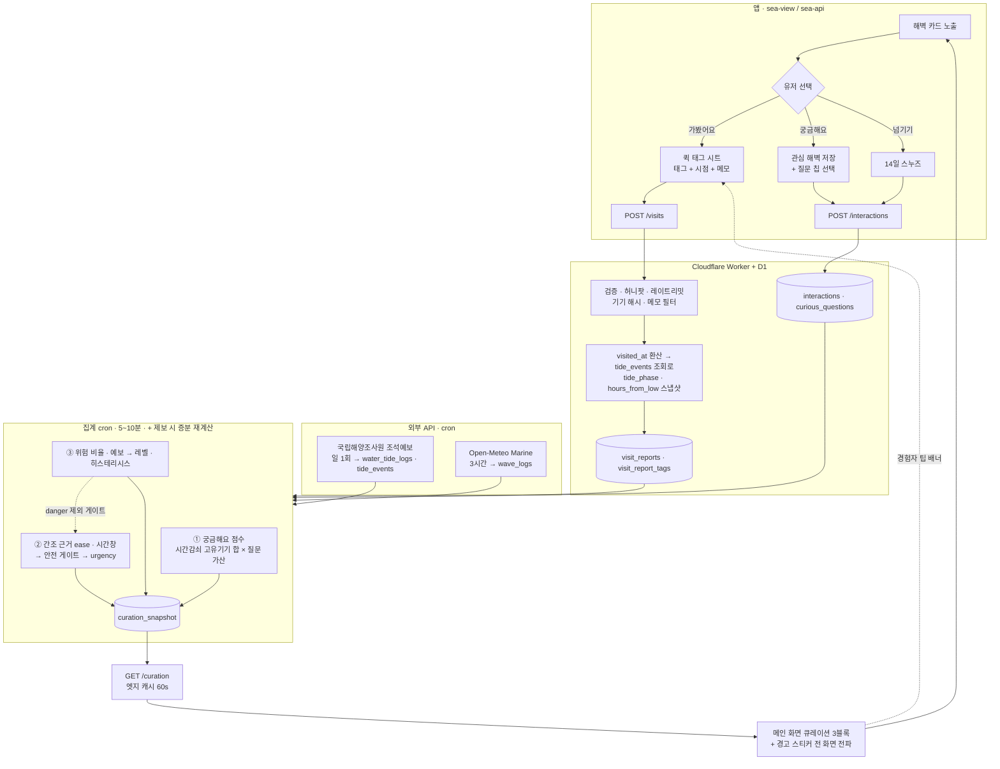

# PRD · 해벽(Sea Cliff) "여기 가봤나요?" 카드 & 자동 큐레이션

| 항목 | 내용 |
|---|---|
| 서비스 | 해벽 · haebyeok.app (바닐라 JS ES 모듈 정적 웹앱 + Cloudflare Worker) |
| 대상 | 자연암벽 모드 중 해안가 암장(이하 "해벽") |
| 상태 | Draft v0.1 (2026-10-18) |
| 한 줄 요약 | 물때·파도가 등반 가능 여부를 정하는 해벽에서, 유저의 3초 탭(가봤어요/궁금해요)으로 현장 데이터를 모아 메인 화면에 3종 자동 큐레이션을 만든다. |

---

## 0. 설계 전제 (현재 코드베이스 제약)

기획이 실제 구현으로 이어지도록 현재 앱의 제약을 먼저 못 박는다.

| 현재 상태 | 이 PRD의 결정 |
|---|---|
| 서버·빌드 없는 정적 앱. 필터·즐겨찾기는 `localStorage`만 사용 (README: "운영자가 모으는 개인정보 없음") | 피드백 집계에는 서버 저장이 필수. **로그인 없는 익명 기기 토큰**(랜덤 UUID, 서버에는 해시만 저장)으로 처리. 개인정보(이름·이메일·정밀 위치) 수집 없음. README·개인정보 문구 갱신 필요 |
| 이미 Cloudflare Worker가 있음 (`config.boardUrl`, `src/board-api.js`, 허니팟 `hp`, `credentials:'omit'`, 빈 URL = 기능 OFF) | **같은 Worker에 `/v1/sea/*` 라우트 추가** + D1(SQLite) 사용. `config.seaUrl`이 비어 있으면 기능 전체 OFF (기존 패턴 동일) |
| 날씨: Open-Meteo 시간별 예보(`src/weather.js`) | 파고·너울은 **Open-Meteo Marine API**(`wave_height`, `swell_wave_height`, `swell_wave_period`)를 같은 방식의 순수 파서로 추가 |
| 혼잡도: Google Form → CSV 요약 (`src/crowd.js`) | 해벽 피드백은 폼/CSV로는 실시간 집계가 어려우므로 Worker로 분리. 기존 혼잡도 제보는 그대로 유지 |
| 순수 모델(DOM·네트워크 없음) + `app.js`가 fetch/렌더 | 같은 구조 유지: `sea-model.js`(순수 랭킹 로직, 테스트 용이) / `sea-api.js`(fetch 어댑터) / `sea-view.js`(렌더) |

> **안전 원칙**: 이 기능은 "등반 가능 여부를 단정"하지 않는다. 모든 큐레이션 문구는 *참고 정보*이며, 파도·물때 판단의 책임은 클라이머에게 있다는 고지를 상시 노출한다(§2.7).

---

## 1. 목표 / 비목표

### 목표
1. 해벽 카드에서 **3초 안에** 반응(가봤어요 / 궁금해요 / 넘기기)을 남길 수 있다.
2. 자유 입력 없이 **태그 탭만으로** 물때 맥락이 포함된 현장 데이터를 수집한다.
3. 수집 데이터 + 물때/파고 API로 메인에 **3개 자동 큐레이션 블록**을 생성한다 (수동 편집 불필요).
4. 미경험 유저의 수요("궁금해요")를 경험 유저의 공급("팁 남기기")으로 연결하는 루프를 만든다.

### 비목표 (v1)
- 로그인/회원가입, 프로필, 팔로우
- 정밀 위치 기반 방문 인증 (개인정보 이슈, v1에서는 신뢰도 가중치로 대체)
- 푸시 알림 (v2 후보: "관심 해벽 물때 열림")
- 공식 안전 판정/예보 대체 (참고 정보만 제공)

---

## 2. 기능 요구사항

### 2.1 해벽 인터랙티브 카드 "여기 가봤나요?"

**노출 조건**: 자연암벽 모드 + 해안 암장(`coastal: true`) 카드. 이미 반응한 해벽은 카드 하단에 상태 칩으로 접힘.

**3선택 액션**

| 버튼 | 동작 | 저장 |
|---|---|---|
| 🙋‍♂️ 가봤어요! | 퀵 태그 시트 오픈(§2.2). 시트 닫기만 해도 "가봤어요" 자체는 저장 | `interactions(kind=visited)` + `visit_reports` |
| 🧐 궁금해요 | 관심 해벽 리스트에 저장 + (선택) 질문 칩 1탭(§2.3) | `interactions(kind=curious)` |
| ✕ 넘기기 | 이 카드 스와이프 아웃, 같은 해벽은 14일간 카드 큐에서 제외 | `interactions(kind=skipped, snooze_until)` |

- 상태는 **해벽당 1개 현재값**: `visited`는 `curious`를 대체(궁금증 해소), `skipped`는 둘 다 덮지 않음(이미 visited/curious면 넘기기 무시).
- 낙관적 UI: 탭 즉시 로컬 반영 → 백그라운드 전송 → 실패 시 `localStorage` 큐에 보관 후 재시도 (오프라인 PWA 대응).
- 키보드/스크린리더: 버튼 3개는 `role=group aria-label="이 해벽 반응"`, 스와이프는 보조 제스처일 뿐 버튼이 기본.

### 2.2 [가봤어요!] 3초 퀵 태그 시트

바텀시트, 기본 높이 ~50%. **필수 입력 없음** — 태그 0개로 "완료"해도 저장된다.

**① 방문 시점 (자동 + 1탭 보정)**
- 기본값 "오늘" / 칩: `오늘 · 어제 · 이번 주 · 더 전`. 선택한 시점 + 서버 시각으로 `visited_at` 확정.
- 서버가 `visited_at` 시점의 **물때 상태를 자동 계산해 같이 저장**(§3 `tide_phase`, `hours_from_low`). 유저는 물때를 입력하지 않는다 → "간조 때 갔는지"는 유저 기억이 아니라 시각으로 환산되므로 **태그가 물때와 결합된 데이터가 된다**. (예: "#만조시베이스잠김"이 정말 만조 부근 제보인지 검증 가능)

**② 물때/진입 상태 (복수 선택)**

| 태그 key | 라벨 | 성격 |
|---|---|---|
| `low_tide_easy` | #간조때진입수월 | 긍정 · 물때 의존 |
| `high_tide_flooded` | #만조시베이스잠김 | 위험 · 물때 의존 |
| `wave_wet` | #파도높아젖음 | 위험 · 파도 의존 |

**③ 환경/어프로치 (복수 선택)**

| 태그 key | 라벨 | 성격 |
|---|---|---|
| `path_slippery` | #진입길미끄러움 | 주의 |
| `wind_strong` | #바람강함 | 주의 |
| `shade_cool` | #그늘시원함 | 긍정 |
| `parking_easy` | #주차편함 | 긍정 |

**④ 완등 메모 (선택, 최대 80자)**
- placeholder: "예) 간조 전후 2시간만 등반 가능 / 너울성 파도 주의"
- 서버 검증: 길이, 연락처·URL 패턴 차단, 금칙어, 허니팟(`hp`), IP/토큰 레이트리밋. 신고 3건 이상 시 자동 숨김.
- 메모는 큐레이션 *점수에는 사용하지 않음*(비정형). 카드 "경험자 팁"으로만 노출.

**완료**: 버튼 `기록하기` → 토스트 "고마워요! 이 해벽을 궁금해한 클라이머 12명에게 도움이 돼요" (수요 수치 노출로 기여 동기 부여).

### 2.3 [궁금해요]

1. 즉시 저장 + 하트 모션. **관심 해벽** 리스트(내 정보 시트 내 탭, 기존 즐겨찾기와 분리 또는 통합 여부는 §8 열린 질문)에 추가.
2. 같은 시트 안 **질문 칩 1탭(선택)**: 
   `진입 가능한 물때가 궁금해요` · `파도 높을 때 괜찮나요?` · `베이스 잠기나요?` · `초보도 갈 수 있나요?` · `주차/어프로치가 궁금해요`
   → `curious_questions`에 저장, 블록 ①의 수요 문구에 사용.
3. **경험자 팁 우선 노출 연동**: 관심 해벽의 상세/카드에서 정렬을 `최신 가봤어요 피드백 → 현재 물때와 유사한 시점의 제보 → 메모 있는 제보` 순으로 고정. 관심 해벽에 새 `visited` 제보가 들어오면 홈 상단에 "새 소식 N" 점(앱 열 때 표시, 푸시 아님).

### 2.4 자동 큐레이션 ① "🌊 요즘 클라이머들이 가장 궁금해하는 해벽 Top 5"
- 순위: **시간 감쇠된 [궁금해요] 고유 유저 수**(§4.2 알고리즘).
- 각 항목에 상위 질문 1~2개를 문구로 표출: "진입 가능한 물때가 궁금해요 · 8명".
- **경험자 참여 배너**: 기기에 `visited` 이력이 있는 해벽이 Top 5에 있으면 해당 항목 하단에 "다녀오셨죠? 경험자 팁을 남겨주세요 →" 배너 → 퀵 태그 시트 바로 열기. (수요 대비 최근 30일 팁이 적은 해벽일수록 우선 노출 = `tip_gap`)
- 최소 노출 기준: 고유 궁금해요 ≥ 3 (콜드스타트 시 §6.2).

### 2.5 자동 큐레이션 ② "⏰ 지금(오늘) 물때 딱 맞춰 가기 좋은 해벽"
- 조건: 해벽 주변 조위 관측소 매핑 + 오늘 간조 시각 + `#간조때진입수월` 근거 + 안전 게이트 통과(§4.3).
- 형태: "오늘 오후 간조 **14:00** 기준 · 진입 가능 **12:00~16:00** · 지금 출발하면 딱 좋아요" 
- 상태 3종: `🟢 지금 열림` / `🟡 N시간 뒤 열림` / `⚪ 오늘은 닫힘`(간조가 이미 지났거나 파고 초과).
- 진입 가능 창(window)은 하드코딩이 아니라 **해당 해벽의 `low_tide_easy` 제보가 몰린 간조 기준 ±시간 분포**로 학습(제보가 적으면 기본 ±2h).

### 2.6 자동 큐레이션 ③ "⚠️ 파도/만조 주의 및 실시간 현황 암장"
- 최근 14일 제보 중 `wave_wet` + `high_tide_flooded` 비율이 높거나, 파고 예보가 임계 초과인 해벽에 **자동 경고 스티커** 부착.
- 스티커는 큐레이션 블록뿐 아니라 **지도 마커, 카드, 상세**에도 동일하게 붙는다(일관성).
- "실시간 현황": 마지막 제보 경과 시간 + 최근 24h 제보 수 + 제보 시점의 물때 상태. 예) "42분 전 · 만조 부근 제보 · #만조시베이스잠김 3건".
- 스티커는 **조건이 사라지면 자동 해제**(감쇠 + 현재 물때가 위험 구간을 벗어남).

### 2.7 공통 고지
모든 큐레이션 블록 하단: "유저 제보와 예보를 바탕으로 한 참고 정보예요. 현장 파도·물때는 직접 확인하고, 위험하면 등반하지 마세요." (블록 접기 불가, 작은 글씨 가능하나 대비비 4.5:1 유지)

---

## 3. 데이터베이스 스키마 (Cloudflare D1 / SQLite)

ID는 `TEXT`(ULID), 시각은 UTC epoch 초(`INTEGER`). 앱의 기존 암장 키(`data/*.json`의 `walls[].name`)를 `crag_id`로 사용(정규화된 slug 권장).

```sql
-- 3.1 기기(익명 유저) ----------------------------------------------------------
CREATE TABLE devices (
  device_hash   TEXT PRIMARY KEY,        -- SHA-256(client_uuid + server_pepper). 원본 UUID는 저장 안 함
  first_seen_at INTEGER NOT NULL,
  trust_score   REAL    NOT NULL DEFAULT 1.0,   -- 스팸 판정 시 하향 (0.0~1.0), 집계 가중치에 곱함
  banned_at     INTEGER
);

-- 3.2 해벽 메타 (data/*.json 의 보강 정보를 서버로 시딩) ---------------------------
CREATE TABLE sea_crags (
  crag_id        TEXT PRIMARY KEY,
  name           TEXT NOT NULL,
  lat            REAL NOT NULL,
  lng            REAL NOT NULL,
  tide_station   TEXT NOT NULL,          -- 조위 관측소 코드 (국립해양조사원 DT_xxxx)
  facing         TEXT,                   -- 'N','NE',... (파도 노출 방향 판단용)
  wave_limit_m   REAL NOT NULL DEFAULT 1.5,   -- 이 값 이상이면 "파도 주의" 게이트 (해벽별 운영자 조정)
  base_flood_h   REAL,                   -- 조위(m) 이 값 이상이면 베이스 잠김 추정 (데이터 쌓이면 학습)
  window_before_min INTEGER NOT NULL DEFAULT 120,   -- 간조 전 진입 가능 폭 (학습값, 기본 ±2h)
  window_after_min  INTEGER NOT NULL DEFAULT 120,
  active         INTEGER NOT NULL DEFAULT 1
);

-- 3.3 유저 반응(현재 상태 1행) ---------------------------------------------------
CREATE TABLE interactions (
  device_hash  TEXT NOT NULL REFERENCES devices(device_hash),
  crag_id      TEXT NOT NULL REFERENCES sea_crags(crag_id),
  kind         TEXT NOT NULL CHECK (kind IN ('visited','curious','skipped')),
  created_at   INTEGER NOT NULL,
  updated_at   INTEGER NOT NULL,
  snooze_until INTEGER,                  -- skipped 전용
  PRIMARY KEY (device_hash, crag_id)     -- 해벽당 1개 현재값. 'visited' > 'curious' > 'skipped' 우선순위로 갱신
);
CREATE INDEX idx_inter_crag_kind ON interactions(crag_id, kind, updated_at);

-- 3.4 [궁금해요] 질문 (선택) ----------------------------------------------------
CREATE TABLE curious_questions (
  id         TEXT PRIMARY KEY,
  device_hash TEXT NOT NULL,
  crag_id    TEXT NOT NULL,
  question   TEXT NOT NULL CHECK (question IN
             ('tide_window','wave_ok','base_flood','beginner_ok','access_parking')),
  created_at INTEGER NOT NULL,
  UNIQUE (device_hash, crag_id, question)
);

-- 3.5 [가봤어요] 방문 제보 (이벤트, 여러 번 가능) ---------------------------------
CREATE TABLE visit_reports (
  id             TEXT PRIMARY KEY,
  device_hash    TEXT NOT NULL,
  crag_id        TEXT NOT NULL,
  visited_at     INTEGER NOT NULL,       -- 유저 선택 시점(오늘/어제/…)을 서버가 환산한 값
  reported_at    INTEGER NOT NULL,       -- 서버 수신 시각
  -- 서버가 visited_at 기준으로 계산해 고정 저장 (조석표가 바뀌어도 당시 맥락 보존)
  tide_phase     TEXT CHECK (tide_phase IN ('low','rising','high','falling')),
  hours_from_low REAL,                   -- 가장 가까운 간조까지 시간 (-6.2 ~ +6.2)
  tide_height_cm INTEGER,
  wave_height_m  REAL,                   -- 당시 파고 (Marine API 과거값/예보 스냅샷)
  memo           TEXT,                   -- ≤ 80자, 검수 통과분만
  memo_status    TEXT NOT NULL DEFAULT 'ok' CHECK (memo_status IN ('ok','hidden','pending')),
  weight         REAL NOT NULL DEFAULT 1.0   -- 신뢰 가중치 (§4.1)
);
CREATE INDEX idx_vr_crag_time ON visit_reports(crag_id, visited_at DESC);

-- 3.6 태그 사전 + 제보-태그 연결 --------------------------------------------------
CREATE TABLE tags (
  tag_key     TEXT PRIMARY KEY,          -- 'low_tide_easy' ...
  label       TEXT NOT NULL,             -- '#간조때진입수월'
  category    TEXT NOT NULL CHECK (category IN ('tide','env')),
  polarity    TEXT NOT NULL CHECK (polarity IN ('good','caution','danger')),
  tide_bound  INTEGER NOT NULL DEFAULT 0,   -- 1: 물때와 결합해서 해석 (low_tide_easy, high_tide_flooded)
  sort_order  INTEGER NOT NULL,
  active      INTEGER NOT NULL DEFAULT 1
);
INSERT INTO tags VALUES
 ('low_tide_easy',     '#간조때진입수월',   'tide','good',   1, 1, 1),
 ('high_tide_flooded', '#만조시베이스잠김', 'tide','danger', 1, 2, 1),
 ('wave_wet',          '#파도높아젖음',     'tide','danger', 0, 3, 1),
 ('path_slippery',     '#진입길미끄러움',   'env', 'caution',0, 4, 1),
 ('wind_strong',       '#바람강함',         'env', 'caution',0, 5, 1),
 ('shade_cool',        '#그늘시원함',       'env', 'good',   0, 6, 1),
 ('parking_easy',      '#주차편함',         'env', 'good',   0, 7, 1);

CREATE TABLE visit_report_tags (
  report_id TEXT NOT NULL REFERENCES visit_reports(id) ON DELETE CASCADE,
  tag_key   TEXT NOT NULL REFERENCES tags(tag_key),
  PRIMARY KEY (report_id, tag_key)
);
CREATE INDEX idx_vrt_tag ON visit_report_tags(tag_key, report_id);

-- 3.7 물때 로그 (WaterTideLogs) — 일 1회 cron 으로 적재 ---------------------------
CREATE TABLE water_tide_logs (
  station     TEXT    NOT NULL,          -- sea_crags.tide_station
  ts          INTEGER NOT NULL,          -- 10분 간격 정시 (조위 곡선)
  height_cm   INTEGER NOT NULL,          -- 조위
  source      TEXT    NOT NULL,          -- 'khoa_forecast'
  PRIMARY KEY (station, ts)
);
CREATE TABLE tide_events (               -- 간조/만조 극값 (조회·랭킹의 주 입력)
  station  TEXT    NOT NULL,
  ts       INTEGER NOT NULL,
  type     TEXT    NOT NULL CHECK (type IN ('low','high')),
  height_cm INTEGER NOT NULL,
  PRIMARY KEY (station, ts)
);

-- 3.8 파고/너울 스냅샷 (Open-Meteo Marine, 3시간 cron) ------------------------------
CREATE TABLE wave_logs (
  crag_id       TEXT    NOT NULL,
  ts            INTEGER NOT NULL,
  wave_m        REAL    NOT NULL,
  swell_m       REAL,
  swell_period_s REAL,
  is_forecast   INTEGER NOT NULL DEFAULT 1,
  PRIMARY KEY (crag_id, ts)
);

-- 3.9 집계 캐시 (큐레이션 결과 — 읽기 API 가 이 테이블만 읽음) --------------------------
CREATE TABLE curation_snapshot (
  block        TEXT NOT NULL CHECK (block IN ('curious_top','tide_now','hazard')),
  crag_id      TEXT NOT NULL,
  rank         INTEGER,
  score        REAL NOT NULL,
  payload_json TEXT NOT NULL,            -- 문구 재료: 수요 수, 상위 질문, 창(window), 스티커 레벨, 근거 건수 …
  computed_at  INTEGER NOT NULL,
  PRIMARY KEY (block, crag_id)
);

-- 3.10 운영 -----------------------------------------------------------------
CREATE TABLE memo_flags (
  report_id TEXT NOT NULL, device_hash TEXT NOT NULL, created_at INTEGER NOT NULL,
  PRIMARY KEY (report_id, device_hash)
);
```

**설계 포인트**
- `interactions`는 **현재 상태**, `visit_reports`는 **이벤트 로그**로 분리: 같은 해벽을 여러 번 방문해 다른 물때 데이터를 쌓을 수 있고, 궁금해요 수 집계는 단순하다.
- `tide_phase`/`hours_from_low`를 제보 시점에 **스냅샷 고정**: 태그가 어떤 물때에 대한 증언인지 보존해야 "간조 14:00 기준" 큐레이션이 성립한다.
- 읽기 경로는 `curation_snapshot` 한 테이블 → 엣지 캐시(60초) 가능, 앱 기동 시 요청 1회.
- 삭제권: 기기 토큰으로 "내 반응 모두 삭제" 엔드포인트 제공(`DELETE /v1/sea/me`).

### API 요약 (`/v1/sea/*`)

| Method | Path | 설명 |
|---|---|---|
| POST | `/interactions` | `{crag, kind, question?, snooze?}` |
| POST | `/visits` | `{crag, when, tags[], memo?, hp}` → `{report, tide_phase}` |
| GET | `/curation` | 3개 블록 스냅샷 + 서버 시각 (+ `If-None-Match`) |
| GET | `/crags/:id/feedback` | 최신 경험자 피드백(정렬 §2.3), 페이지네이션 |
| GET | `/me` | 내 반응/관심 해벽 동기화 |
| DELETE | `/me` | 내 반응 전체 삭제 |

---

## 4. 큐레이션 랭킹 알고리즘

### 4.1 공통 입력과 가중치

```
신뢰 가중치 w(report) = trust(device) × recency(visited_at) × freshness_of_report
  recency = exp(-ln2 × age_days / H)      H: 블록별 반감기
  trust   = devices.trust_score (기본 1.0, 스팸 의심 시 ↓)
```

| 블록 | 반감기 H | 최소 근거 | 이유 |
|---|---|---|---|
| ① 궁금해요 | 14일 | 고유 기기 ≥ 3 | 관심은 빨리 식음 |
| ② 간조 진입 | 90일 | 조건 일치 제보 ≥ 3 | 물때 패턴은 주기적이라 오래 유효 |
| ③ 위험 | 5일 | 최근 14일 제보 ≥ 3 | 파도/상태는 빨리 바뀜 — 오래된 경고가 남으면 신뢰 하락 |

### 4.2 블록 ① 궁금해요 Top 5

```
demand(c)   = Σ_{d ∈ curious devices} trust(d) × 2^(-age_d / 14d)
q_boost(c)  = 0.3 × (질문을 남긴 고유 기기 수 / 궁금해요 고유 기기 수)       # 구체적 수요일수록 가산
score(c)    = demand(c) × (1 + q_boost(c)) × (1 − 0.5 × visited_fresh_ratio(c))   # 이미 정보가 충분한 곳은 소폭 하향해 새 곳에 노출 분산
hide_if     = 고유 기기 < 3        # 위험 스티커가 붙은 해벽도 제외하지 않고 '⚠️'만 병기(수요 정보는 유지)
tip_gap(c)  = demand(c) − 최근 30일 visit_reports(w 합)       # 클수록 "경험자 팁 남기기" 배너 우선
```
- 상위 5개, 동점은 최근 궁금해요가 많은 순.
- `payload`: `{curious_count, top_questions:[{q,count}], tip_gap, fresh_tip_count}`.

### 4.3 블록 ② 지금 물때 맞는 해벽 (핵심: 물때 × 태그 × 안전 게이트)

```
for each crag c with tide_station:
  L = 오늘(KST) 남은/진행 중 간조 이벤트 중 now−window_after … now+8h 안의 것
  if L 없음 → 후보 아님

  # (a) 근거: 간조 부근 제보 중 긍정 비율 (베타 사전 확률로 소표본 보정)
  near_low = { r ∈ visit_reports(c) : |hours_from_low| ≤ 2 }
  pos      = Σ w(r)  for r ∈ near_low with tag low_tide_easy
  neg      = Σ w(r)  for r ∈ near_low without it  (혹은 만조/파도 위험 태그 동반)
  ease(c)  = (pos + 1) / (pos + neg + 2)           # Beta(1,1) 스무딩
  gate_evidence = (near_low 건수 ≥ 3) and ease ≥ 0.6

  # (b) 안전 게이트 (하나라도 걸리면 제외 — 제보보다 예보/위험 신호가 우선)
  gate_wave   = max(wave_m  in [L−window_before, L+window_after]) < wave_limit_m
  gate_hazard = hazard_level(c) ≠ danger          # 블록 ③ 결과 재사용
  
  # (c) 시간 창 (학습)
  window = [L − window_before, L + window_after]   # 기본 ±120분, 
           # near_low 제보의 hours_from_low 분포에서 P10~P90 으로 갱신(제보 ≥ 10건일 때만)
  status = 지금 열림 | N시간 뒤 열림 | 닫힘(window 종료)

  # (d) 정렬 점수
  urgency  = 지금 열림 → 1.0 ;  1~3h 뒤 열림 → 0.7 ;  그 외 → 0.3
  score    = ease(c) × urgency × confidence(n)        # confidence = min(1, n/10)
  if 사용자 위치 허용: score *= 거리 감쇠(이동시간이 window 닫히기 전 도착 가능할 때만)
```
- 출력: 상위 5개 이하, 문구 템플릿 `"오늘 {오전|오후} 간조 {HH:MM} 기준 · {window} · {status 문구}"`.
- 후보가 0개면 블록을 **숨기지 않고** "오늘은 물때 조건이 맞는 해벽이 없어요. 대신 내일 간조는 …" 빈 상태 표시(§5.5).

### 4.4 블록 ③ 파도/만조 주의 및 현황

```
recent   = 최근 14일 visit_reports (w, 반감기 5일)
hazard_w = Σ w(r)  for r with tag ∈ {wave_wet, high_tide_flooded}
total_w  = Σ w(r)
hazard_ratio(c) = hazard_w / total_w         # total_w 의 유효 건수 ≥ 3 필요

# 예보 기반 신호 (제보가 없어도 작동)
forecast_wave = max(wave_logs.wave_m in [now, now+6h])
forecast_hi   = 다음 6h 내 만조 존재 & 만조 조위 ≥ base_flood_h

# 현재 물때가 위험 태그의 '발생 구간'과 겹치는가 (high_tide_flooded 는 tide_bound)
phase_match = 지금 hours_from_low 와 위험 제보들의 hours_from_low 가 ±1.5h 이내인 제보 비중

level(c) =
  danger  if hazard_ratio ≥ 0.6  and phase_match ≥ 0.5   or  forecast_wave ≥ wave_limit_m × 1.5
  caution if hazard_ratio ≥ 0.35 or  forecast_wave ≥ wave_limit_m or (forecast_hi and phase_match ≥ 0.5)
  none    otherwise
```
- 히스테리시스: 스티커 부착은 위 임계값, **해제는 임계값 −0.1 아래로 내려가고 6시간 경과 시**(깜빡임 방지).
- 정렬: `danger` → `caution`, 같은 레벨 내에서는 `최근 제보 경과 시간` 짧은 순.
- 스티커 문구: `🚫 파도 위험 · 만조 베이스 잠김 3건 (2시간 전)` / `⚠️ 파도 주의 · 예보 파고 1.8m`.

### 4.5 흐름도



핵심 루프: **수요(궁금해요) → 큐레이션 노출 → 경험자 팁 배너 → 가봤어요 제보 → 다음 큐레이션 정확도↑ → 더 많은 수요**.

---

## 5. UI/UX 컴포넌트 레이아웃 가이드 (모바일 우선, 360px 기준)

기존 `style.css`의 카드·바텀시트 토큰을 재사용한다. 새 컴포넌트는 `sea-` 접두 클래스.

### 5.1 메인 화면 구성 순서

```
┌ 상단바 (지금 열린 외벽 · 모드: 자연암벽 ▸ 해벽) ┐
│ ① 🌊 요즘 가장 궁금해하는 해벽 Top 5   [가로 스와이프 카드] │
│ ② ⏰ 지금 물때 딱 맞는 해벽              [세로 리스트 ≤5] │
│ ③ ⚠️ 파도/만조 주의 · 실시간 현황         [경고 스트립]    │
│ ── 기존 지도/리스트 ──                                   │
└──────────────────────────────────────────────┘
```
- 노출 우선순위: **③에 danger가 있으면 ③을 최상단으로 승격**(안전 우선), 없으면 ② → ① 순(실행 가능한 정보 먼저). 블록이 비면 접힌 한 줄 요약.
- 블록 헤더: 제목 + `갱신 3분 전` + 정보(ⓘ) 탭 시 산정 기준 설명(투명성).

### 5.2 해벽 "여기 가봤나요?" 카드

```
┌────────────────────────────────────────┐
│ [사진]                         ⚠️ 파도 주의 │  ← 우상단 스티커(§5.6)
│ 🌊 OO 해벽 · 강원 OO군                      │
│ 오늘 간조 14:02 · 만조 20:10 · 파고 0.8m     │  ← 물때 한 줄 (조석+파고)
│ 가본 사람 12 · 궁금해요 31                   │
│                                              │
│ "간조 전후 2시간만 등반 가능" — 2시간 전      │  ← 최신 경험자 팁 1줄(있을 때)
│                                              │
│ [🙋‍♂️ 가봤어요!] [🧐 궁금해요] [✕ 넘기기]    │  ← 동일 너비 3분할, 높이 48px
└────────────────────────────────────────┘
```
- 버튼 터치 영역 ≥ 44×44px. `가봤어요`는 Primary(채움), `궁금해요`는 Secondary(외곽선), `넘기기`는 Tertiary(텍스트).
- 반응 후: 버튼 행이 상태 칩으로 전환 — `✅ 다녀옴 · 수정` / `💙 관심 해벽 · 취소`.

### 5.3 퀵 태그 시트

```
┌──────────────────────────────────────┐
│ ━━                                    │
│ OO 해벽, 어땠어요?          (3초면 끝!) │
│ 언제 갔어요? (오늘)(어제)(이번 주)(더 전) │
│ ─ 물때 / 진입 ──────────────────────  │
│ (#간조때진입수월)(#만조시베이스잠김)      │
│ (#파도높아젖음)                         │
│ ─ 환경 / 어프로치 ──────────────────  │
│ (#진입길미끄러움)(#바람강함)             │
│ (#그늘시원함)(#주차편함)                 │
│ ─ 완등 메모 (선택) ─────────────────  │
│ [ 예) 간조 전후 2시간만 등반 가능…  0/80 ]│
│ [         기록하기          ]           │
│ 가볍게 남겨주세요. 개인정보는 적지 마세요. │
└──────────────────────────────────────┘
```
- 태그는 토글 칩(`aria-pressed`). 위험 태그 선택 시 칩 색이 경고색으로 변경, 긍정은 기본 강조색.
- **상충 태그 경고**: `간조때진입수월` + `만조시베이스잠김` 동시 선택 시 "같은 날 다른 물때였나요?" 인라인 안내(차단 아님, 시점 칩으로 분리 제보 유도).
- 키보드가 올라오면 시트 높이 유지, 기록하기 버튼 sticky.
- 완료 토스트에 *내 제보의 물때 결과*를 보여줌: "간조 +1시간 시점 제보로 기록됐어요" (제보가 어떻게 쓰이는지 학습).

### 5.4 블록별 컴포넌트

**① 궁금해요 Top 5 — 가로 카드 캐러셀**
```
┌──────────────┐
│ 1  OO 해벽    │   순위 배지(1~5)
│ 💙 궁금해요 31 │
│ "진입 가능한   │   상위 질문 (최대 2줄, 건수)
│  물때가 궁금해요" · 8명 │
│ ┌──────────┐ │
│ │ 다녀오셨죠? │ │  ← 경험 이력 기기에만 노출되는 참여 배너
│ │ 팁 남기기 → │ │
│ └──────────┘ │
│ [🧐 나도 궁금]  │
└──────────────┘
```
- 카드 폭 ~76vw, 다음 카드가 살짝 보이게 해 스와이프 어포던스 제공.

**② 지금 물때 맞는 해벽 — 세로 리스트 행**
```
┌───────────────────────────────────────┐
│ 🟢 지금 열림   OO 해벽        1.2km │
│ 오늘 오후 간조 14:00 기준              │
│ ▓▓▓▓░░░ 진입 12:00 ─── 16:00         │  ← 미니 타임라인(조위 곡선 + 진입창 음영 + 현재 시각 마커)
│ #간조때진입수월 9건 · 파고 0.6m         │
└───────────────────────────────────────┘
```
- 상태 색 + **아이콘/텍스트 병행**(색만으로 구분 금지). 미니 타임라인에는 대체 텍스트 "12시부터 16시까지 진입 가능" 제공.

**③ 주의 현황 — 경고 스트립(세로, 강한 대비)**
```
┌───────────────────────────────────────┐
│ 🚫 OO 해벽  파도 위험                   │
│ 42분 전 · 만조 부근 제보 · 베이스 잠김 3건 │
│ 예보 파고 2.1m (기준 1.5m)              │
│                       [자세히 / 제보 보기] │
└───────────────────────────────────────┘
```
- danger는 상단 고정·붉은 계열 좌측 바, caution은 노랑 계열. 해제된 해벽은 사라지며 "방금 해제" 칩을 1시간 표시(깜빡임 방지).

### 5.5 상태 설계

| 상태 | 처리 |
|---|---|
| 로딩 | 스켈레톤 3블록, 레이아웃 시프트 방지 |
| 콜드스타트(근거 부족) | ①: "아직 궁금해요가 모이는 중이에요. 첫 번째로 눌러볼까요?" ②: 물때만 표시(제보 근거 없음 = "유저 제보 대기 중" 라벨) ③: 예보 기반 신호만 |
| 오프라인 | 마지막 스냅샷 + "N분 전 정보" 경고 배지 (오래될수록 안전 문구 강화), 쓰기는 큐 |
| API 오류 | 블록만 숨기고 기존 지도 정상 동작 (`config.seaUrl` OFF와 동일 경로) |
| 후보 없음(②) | "오늘은 조건이 맞는 해벽이 없어요 · 내일 간조 06:40" 안내 |

### 5.6 경고 스티커 스펙

| 레벨 | 아이콘/라벨 | 트리거 | 표시 위치 |
|---|---|---|---|
| `danger` | 🚫 파도 위험 | §4.4 | 카드 우상단, 지도 마커 뱃지, 상세 상단 배너 |
| `caution` | ⚠️ 파도/만조 주의 | §4.4 | 카드 우상단, 마커 뱃지 |
| 정보 | 🕒 N시간 전 정보 | 마지막 제보 6h 이상 경과 | 스티커 옆 보조 텍스트 |

- 스티커 탭 → 근거 시트: 최근 제보 수/비율, 제보 시점의 물때, 예보 파고, 산정 기준 문구.

### 5.7 접근성 · 카피 · 성능
- 색 대비 4.5:1, 상태는 색+아이콘+텍스트 3중 표기, 시트는 포커스 트랩 및 ESC/뒤로가기 닫기, 스와이프에 대응하는 버튼 제공.
- 카피 톤: 기존 앱의 해요체 유지("궁금해요", "팁 남기기"). 위험 문구는 단정 대신 근거 제시("만조 베이스 잠김 3건").
- 성능: 홈 진입 시 `GET /curation` 1회(스냅샷, ETag), 블록 렌더는 데이터 수신 후 지연 로드(번들 증가 최소). `config.seaUrl`이 비면 요청·DOM 모두 생성하지 않음.

---

## 6. 어뷰징 · 신뢰 · 콜드스타트

### 6.1 어뷰징 방어 (로그인 없는 구조에서)
- 해벽당 기기 1표(궁금해요), 방문 제보는 같은 해벽 **하루 1건**, 기기당 일일 제보 상한 20건.
- IP+기기 해시 레이트리밋, 허니팟 필드(기존 `hp` 패턴), 짧은 시간에 다수 해벽 제보 시 `trust_score` 하향.
- 시점 가중: 방문 24시간 내 제보 1.0, 7일 내 0.7, 그 이상 0.4.
- **위험 태그는 보수적으로 처리**: 단일 기기가 위험 스티커를 만들 수 없도록 고유 기기 ≥ 3 필요. 반대로 위험 신호는 *예보*만으로도 발동하므로 제보 조작으로 안전 경고를 끌 수 없다.
- 메모 신고 3건 → 자동 숨김 → 운영자 검수.

### 6.2 콜드스타트
- 시드 데이터: 운영자가 주요 해벽 5~10곳에 운영자 제보(`trust=1.0`, "운영자 확인" 라벨) 입력.
- 노출 임계 미달 해벽은 "데이터 수집 중" 라벨로 *물때만* 보여주고 랭킹에서는 제외.
- 초기 2주는 임계값을 낮추지 않고(안전), 블록 ①만 임계 2로 완화하는 옵션을 설정값으로 둔다.

### 6.3 외부 데이터 장애
- 조석 API 실패 → ② 블록 숨김 + 마지막 정상값의 만료 표시. 파고 API 실패 → ② 후보 전원 "파고 미확인" 라벨 부착(게이트 통과로 간주하지 않음 = **fail-closed**).

---

## 7. 성공 지표 · 출시 계획

| 지표 | 목표(출시 후 4주) |
|---|---|
| 해벽 카드 노출 대비 반응률 (가봤어요+궁금해요) | ≥ 15% |
| 가봤어요 → 태그 1개 이상 선택률 | ≥ 70% |
| 가봤어요 → 메모 작성률 | ≥ 15% |
| Top 5 항목의 경험자 배너 → 제보 전환 | ≥ 8% |
| 해벽 중 큐레이션 임계 충족(근거 ≥3) 비율 | ≥ 60% |
| 위험 스티커 정확도(운영자 샘플 검수) | ≥ 90% |
| 큐레이션 블록 → 상세 진입 CTR | ≥ 12% |

이벤트(기존 GoatCounter 대신 서버 로그/커스텀 이벤트): `sea_card_view`, `sea_react{kind}`, `sea_tag_sheet_submit{tags,memo}`, `sea_block_view{block}`, `sea_block_click{block,crag}`, `sea_banner_tip_click`.

**단계**
1. **P0 (스키마/수집)**: Worker `/v1/sea/*`, D1 마이그레이션, 조석·파고 cron, 카드 + 퀵 태그 시트, `config.seaUrl` 플래그.
2. **P1 (큐레이션)**: `sea-model.js` 랭킹(순수 함수 + 단위 테스트), 블록 ①③ 먼저(제보 의존도 낮음), 경고 스티커 전파.
3. **P2 (물때 큐레이션)**: 블록 ②, 시간창 학습, 위치 기반 이동시간 반영.
4. **P3**: 관심 해벽 알림(PWA 푸시), 시즌/풍향 반영, 사진 제보.

**테스트 계획**: 랭킹 함수는 `npm test`에 순수 모델로 포함 — (a) 반감기 감쇠, (b) 소표본 스무딩, (c) 안전 게이트 우선순위, (d) 히스테리시스, (e) 조석 API 실패 시 fail-closed, (f) 자정/KST 경계, (g) 간조 이벤트가 하루 1~2회인 날 모두.

---

## 8. 열린 질문 (결정 필요)

1. **개인정보 정책**: 익명 기기 토큰 서버 저장을 허용하는가? (README "수집하는 개인정보 없음" 문구 수정 필요)
2. **관심 해벽 vs 기존 즐겨찾기**: 통합할지, 별도 리스트로 둘지.
3. **조석 데이터 소스**: 국립해양조사원 조석예보(공공데이터포털 키 필요) 사용 확정 여부, 해벽별 관측소 매핑 담당.
4. **해안 암장 목록**: `data/national.json`에 `coastal` 플래그/좌표/면 방향을 어떻게 보강할지(운영자 수작업 vs 별도 `data/sea.json`).
5. **파고 임계값**: 기본 1.5m가 적절한지 — 해벽별 운영자 설정 + 안전 자문(현장 클라이머/해양 전문가) 필요.
6. **책임 고지 수위**: 서비스 약관/면책 문구 검토(법무).
7. **위험 스티커 해제 권한**: 자동 해제만 둘지, 운영자 수동 오버라이드(예: 출입 금지 공지)를 추가할지.
